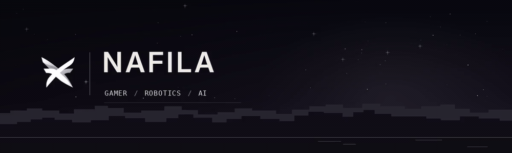
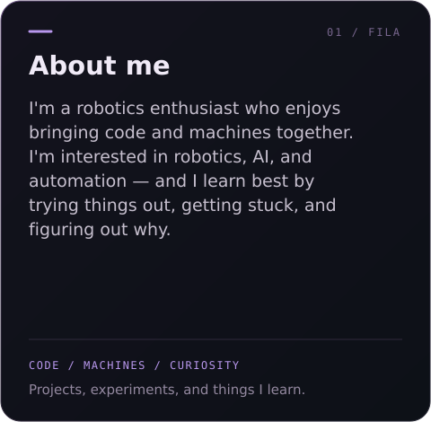
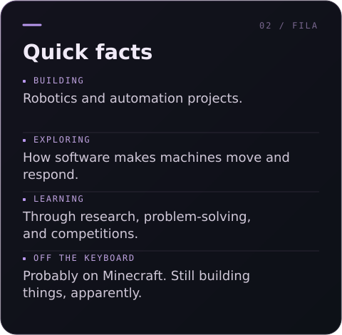

 

---

  
  

---

### 🛠️ Tech Stack

  

  
  
  
  
  

---

### ⛏️ Off the keyboard

Sometimes the project is a robot. Sometimes it's a house made of blocks.

---

  Want to talk about something I've built? 
  Open an issue in the project's repository — I'd love to hear from you.

